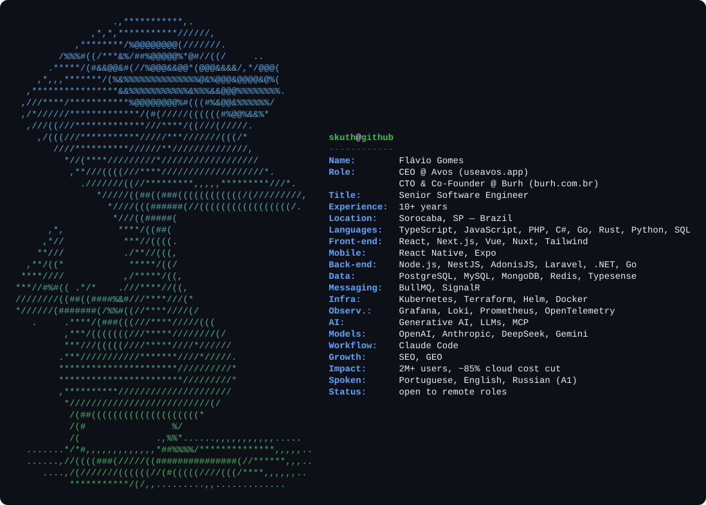

# Flávio Gomes

**CEO at [Avos](https://useavos.app)** · **CTO & Co-Founder at [Burh](https://burh.com.br)** · Senior Software Engineer · Sorocaba, Brazil

Senior Software Engineer with 10+ years of experience across full-stack and mobile, with a focus on performance, software architecture and cloud cost. I'm the CEO of [Avos](https://useavos.app), a multi-country payroll platform built as an event-driven monorepo running on Kubernetes, and CTO & Co-Founder of [Burh](https://burh.com.br), an HR tech platform serving 2M+ users, where I rebuilt the core products on my own with performance as the priority, cut cloud costs by ~85% and drove SEO.

Most of my work today is in generative AI. I ship LLM features in production with OpenAI, Anthropic, DeepSeek and Gemini: résumé parsing and candidate screening with structured outputs, agents with function calling, AI pre-code review in CI and per-provider usage and cost tracking. I also build MCP servers and Claude Code skills, and Claude Code is part of my daily workflow. On the growth side I work with SEO and GEO (Generative Engine Optimization), making products discoverable both in search engines and in AI answers.

On the infrastructure side I design event-driven systems with queues and background workers, and ship them with Infrastructure as Code (Terraform + Helm on Kubernetes) and full observability.

Open to remote international roles.

        

              

 

## Impact

| **2M+** | **~85%** | **99.9%** | **< 200ms** |
|:--:|:--:|:--:|:--:|
| users served at Burh | cloud cost cut $4,000 → ~$600 / month | uptime | API response time |

 

## Experience

**CEO** · [Avos](https://useavos.app) — multi-country payroll platform

- Architected a multi-tenant payroll platform with payroll and tax engines for 14 countries, available in 5 languages
- Structured it as a Turborepo monorepo of 8 apps: Next.js 16 web app, AdonisJS API, Expo mobile app, a separate content service and workers for email, payments, invoicing and push notifications
- Designed an event-driven architecture: the API answers synchronously and hands slow work (SMTP, payment webhooks, tax authorities) to workers through BullMQ queues on Redis, so a slow third party never blocks the API
- Set up PostgreSQL with a write primary and read replicas, plus private S3 storage with per-tenant keys and HMAC-signed URLs
- Built the production infrastructure as code: Kubernetes on DigitalOcean with Terraform and Helm, HPA autoscaling, ingress-nginx with cert-manager TLS, observability with Grafana, Loki and Prometheus, and a local production simulation on kind
- Built provider-agnostic billing (Stripe and Paddle as Merchant of Record) with dunning (grace period → block) and automated Brazilian e-invoice (NFS-e) issuance
- Added LLM features on Anthropic, OpenAI and DeepSeek, with per-provider usage and cost tracking in the admin
- Shipped the employee mobile app: clock-in with geolocation and selfie, payslips and vacations, with push via Web Push and Expo
- Implemented SEO, AEO and GEO: llms.txt, Markdown served on the same URL via the Accept header, a public OpenAPI spec, JSON-LD, sitemap with hreflang and a nightly SEO monitor that checks the sitemap against Google's index

**CTO & Co-Founder** · [Burh](https://burh.com.br) — HR tech platform · Jan 2020 – Present

- Rebuilt Burh's core products from scratch on my own, including the candidate-facing job application platform, with performance as the main goal and SOLID / Clean Architecture underneath
- Cut monthly cloud spend from ~$4,000 to ~$600 (~85%) through service re-architecture, workload consolidation, container right-sizing, caching and a provider migration, keeping 99.9% uptime and sub-200ms APIs for 2M+ users
- Drove SEO across the platform
- Shipped LLM features in production: résumé parsing and AI job screening with structured outputs, interview summaries, document extraction with Gemini and an agent with function calling
- Built the real-time chat service in .NET 10 with SignalR (Redis backplane), PostgreSQL and OpenTelemetry, split into Domain / Application / Infrastructure layers
- Built a log ingestion service in Go and moved job search to Typesense on Laravel 12
- Leading the rebuild of the iOS and Android app with React Native and Expo, with EAS builds and Firebase Crashlytics
- Built GitHub Actions pipelines across the repos: build, test and E2E checks, i18n and changeset checks, and an automated AI pre-code review before human review
- Integrated with Indeed, LinkedIn and several other ATS and job platforms

 

## Stack

| | |
|:--|:--|
| **AI** |        |
| **Front-end** |              |
| **Mobile & Desktop** |     |
| **Back-end** |              |
| **Payments** |    |
| **Data** |         |
| **Infra** |                |
| **Observability** |     |
| **Tools** |           |

 

 

## Activity

 

 

 

